<style>blockquote, table, pre, img { break-inside: avoid; } h2, h3 { break-after: avoid; }</style>

# Rosie Robotics, Team #75872: Robot Design

**Rookie team · 2026 FLL Challenge: Bioglow · Robot: Rosie Rover · Coded in Pybricks (Blocks to Python)**

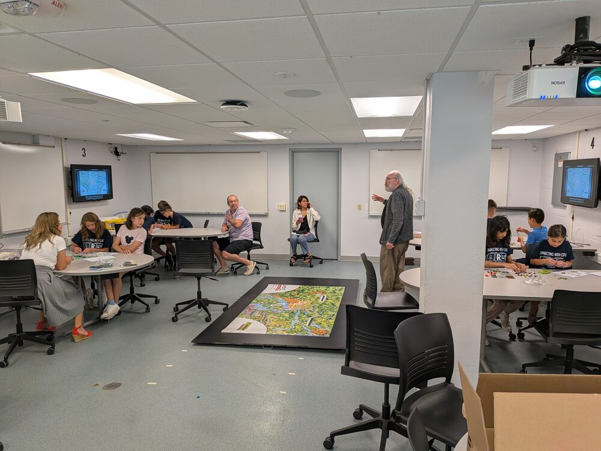 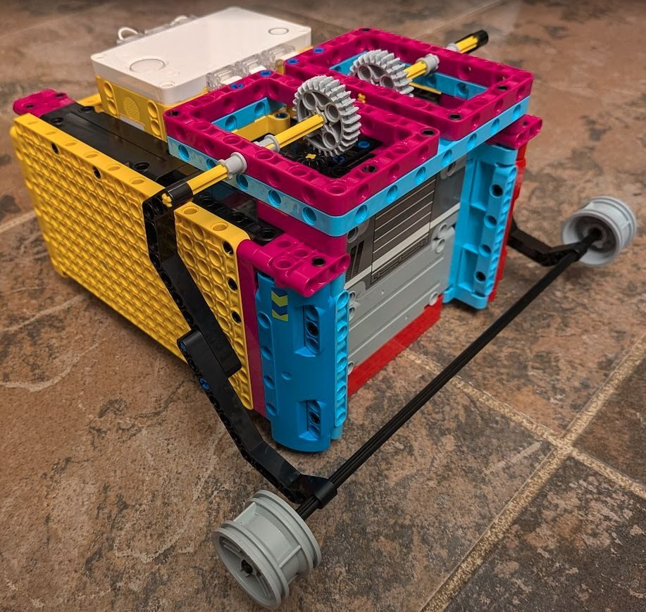

| Rubric | Who's talking | What we'll show |
|---|---|---|
| Identify | **Bowen**, **Lina** | Resources used, robot base, Pybricks + remote, mission strategy |
| Design | **Miriam**, **James** | Mission 1 Drone Survey plan, motor-driven arm (Mission 2 Exploding Seeds, Mission 7 Humongous Fungus) |
| Create | **Jennie** | Mission 13 Keystone Species code and attachment |
| Iterate | **Neala** | How testing changed Mission 13 Keystone Species |
| Communicate | **Nolan**, **Mira** | Lessons learned |

## Identify: Resources & the Robot Base (Bowen)

- **As a rookie team, we started by learning from veteran teams.** The YouTube video
  *"5 Simple Tips to Build the Ultimate FLL Robot"* recommends building one strong
  **base robot** first, then small attachments for each mission.
- **Base:** built following the video's tips, then finished with an original design for the outside panels.
  It has 2 drive motors, **2 attachment motors on top**, and 2 color sensors.
  We made a Pybricks template program for this setup.

  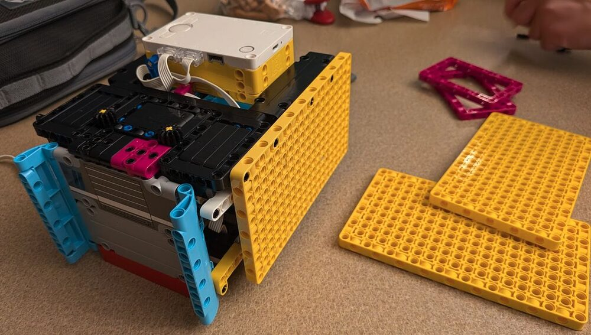 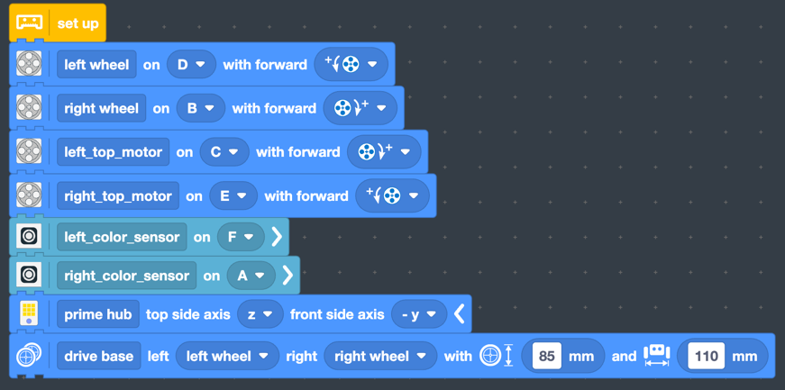

<div style="page-break-after: always"></div>

- **Pybricks instead of the regular SPIKE app:** missions start in Pybricks Blocks, then
  move to Python. Each mission is its own file, and all the code is on GitHub (https://github.com/Rosie-Rover-FLL/bioglow_2026).

  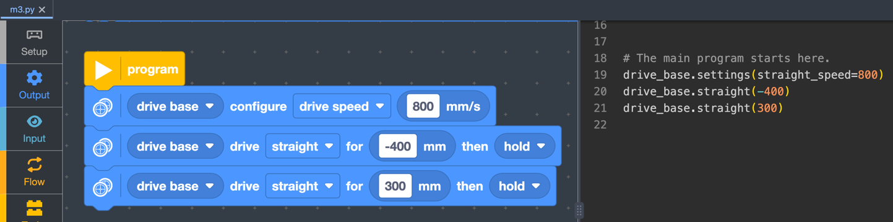

- **Mission menu on the hub:** press left/right to pick a mission number, center to run it.

  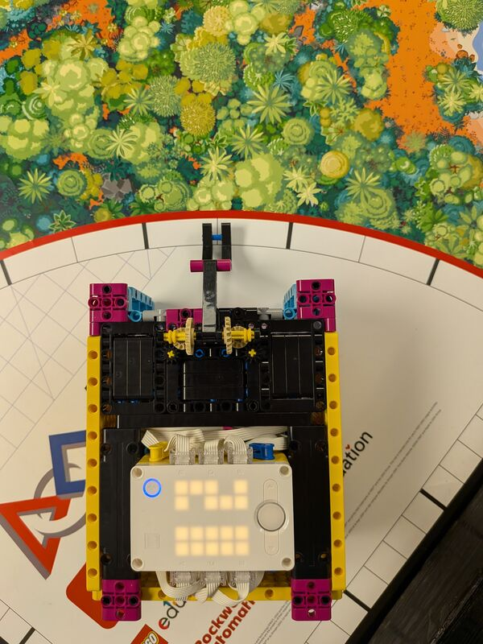

- **Custom remote control:** a second hub. Tilt it to drive, a knob sets the speed,
  and holding a button moves the arm. Used for driving practice and testing attachments. (live demo)

  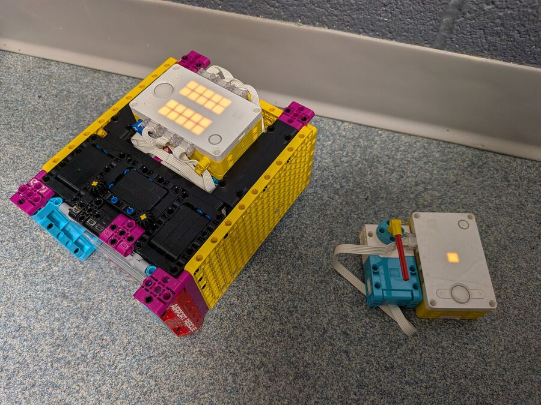

<div style="page-break-after: always"></div>

## Identify: Mission Strategy (Lina)

Missions chosen for **reliability** and the **easiest points**: close to
a launch area, with simple moves.

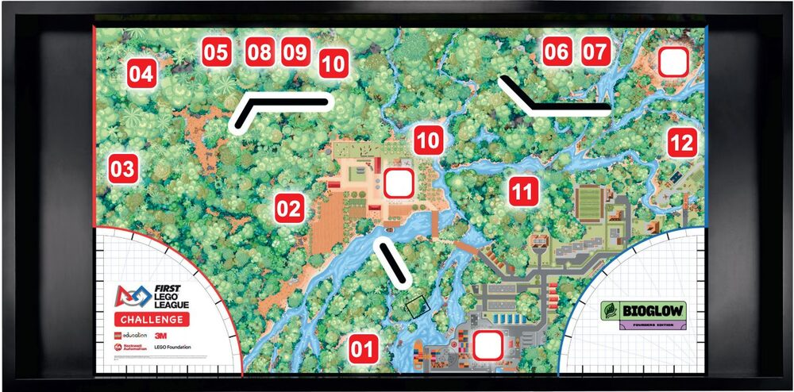

| Mission | Goal pts |
|---|---|
| Equipment inspection | 20 |
| 01 Drone Survey | 20 |
| 02 Exploding Seeds | 20 |
| 03 Flip the Rock | 30 |
| 06 Leafcutter Frenzy (also scores 11 Window to the Past) | 50 |
| 07 Humongous Fungus | 20 |
| 10 Fragile Microhabitats (don't touch it!) | 20 |
| 11 Window to the Past | 20 |
| 13 Keystone Species | 30 |
| 15 Biocentric Architecture | 10 |
| Precision tokens | 50 |
| **Goal** | **290** |

<div style="page-break-after: always"></div>

## Design: Mission 1 Drone Survey and the Arm (Miriam, James)

**Mission 1 Drone Survey (Miriam):** the robot drives backward fast to knock
the drone off the mat, then drives straight home.

**The arm, Mission 2 Exploding Seeds (James):** both top motors turn the arm together. The first version was too weak,
so the speed went way up. The arm lowers again on the way home, ready for the next run.
We might even be able to use the same arm for **Mission 7 Humongous Fungus**.

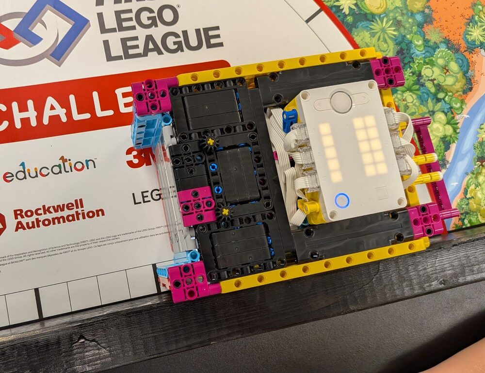 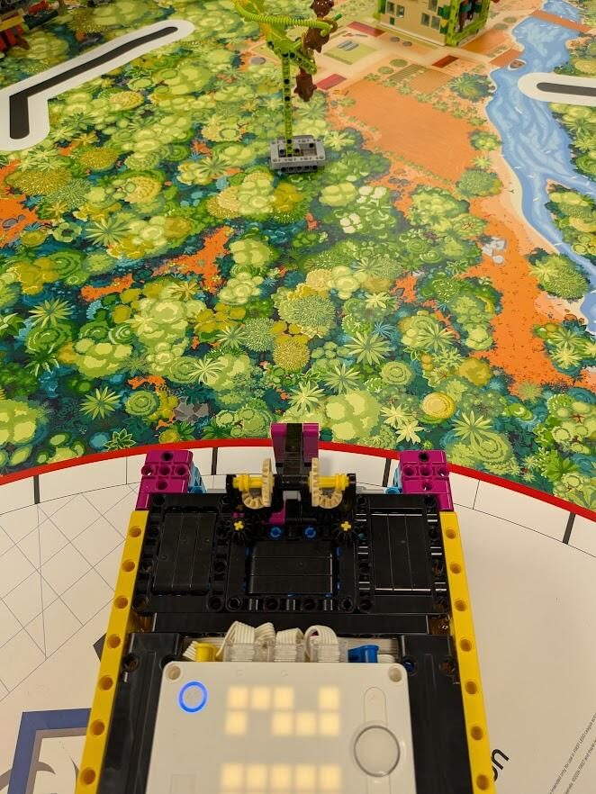

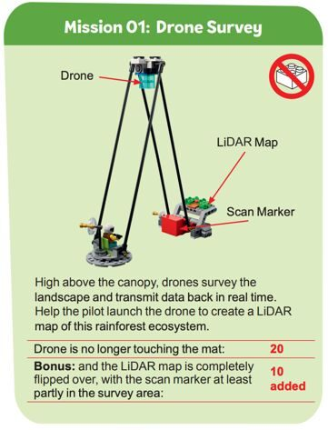 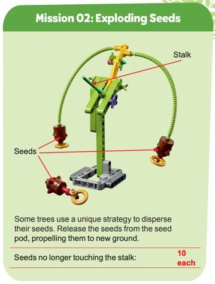 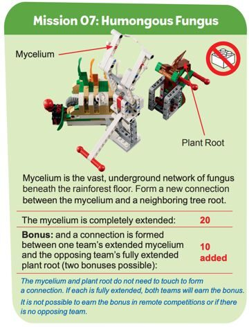

<div style="page-break-after: always"></div>

## Create: Mission 13 Keystone Species (Jennie)

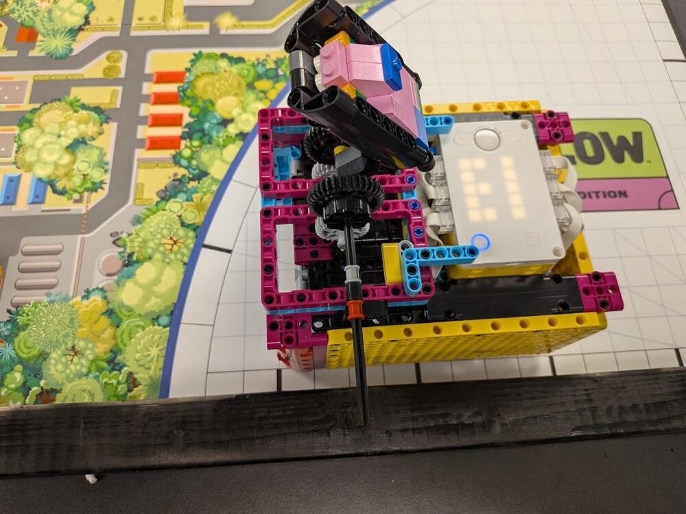 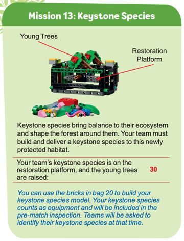

**Keystone species:** a poison dart tree frog. It eats huge numbers of insects and is
food for other animals, so it holds the food web together.

**Attachment:** connects to the top motors with gears, and throws the
keystone species onto the restoration platform.

**Code (Jennie):** first written in Pybricks Blocks. Drive to the platform, run both top
motors at 75% power for 0.4 seconds, then back up.

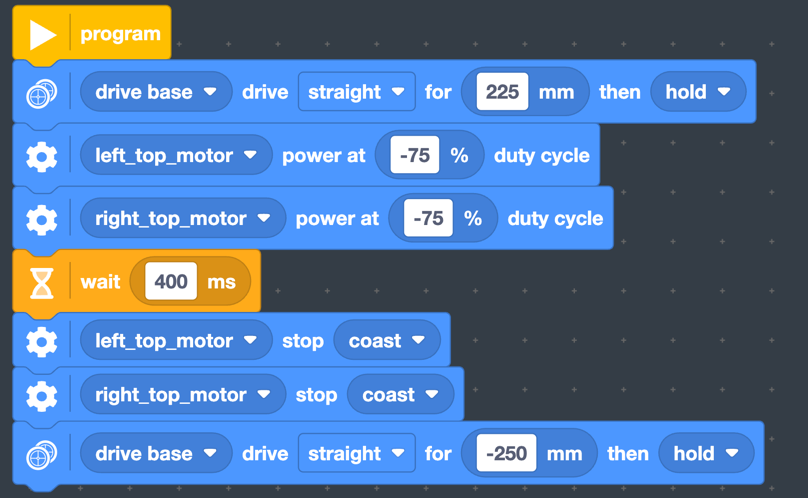

<div style="page-break-after: always"></div>

## Iterate: How Testing Changed Mission 13 Keystone Species (Neala)

Repeated test runs showed two problems:

| Problem found in testing | Fix |
|---|---|
| Not enough power to raise the young trees | Added **weight** to the keystone species, started the attachment **farther back** for more momentum, and raised the throw from 75% to **100% power** |
| The species sometimes missed the center of the platform | Drive out **slower** (300 mm/s) to stop wheel slip, but still drive back **fast** (600 mm/s) |

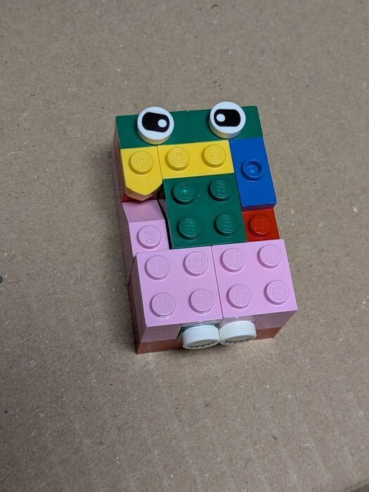

These edits were made directly in the Python code (changes marked `◀`):

```python
drive_base.settings(straight_speed=300)   # ◀ NEW: slow drive out, no wheel slip
drive_base.straight(225)
left_top_motor.dc(-100)                   # ◀ was -75: full-power throw
right_top_motor.dc(-100)                  # ◀ was -75
wait(400)
left_top_motor.stop()
right_top_motor.stop()
drive_base.settings(straight_speed=600)   # ◀ NEW: fast drive home
drive_base.straight(-250)
```

<div style="page-break-after: always"></div>

## Communicate: Lessons Learned (Nolan, Mira)

1. **A robot doesn't do the same thing every time.** The battery, where the robot is
   placed, and wheel slip all matter. The fixes: stall-detect code (if the robot gets stuck,
   it stops and moves on), and gentler starts so the wheels don't slip.
2. **Precision tokens are worth protecting.** Each touch of the robot outside home
   costs a token. Sometimes it's smarter to let a mission fail.
3. **Practice runs taught us the scoring.**

| | Score |
|---|---|
| First full practice run (Oct 11) | 180 |
| *...many more runs not shown...* | ... |
| Practice run (Nov 1) | 230 |
| Practice run (Nov 8) | 220 |
| Current goal | **290** |

The score sheet used at every practice run:

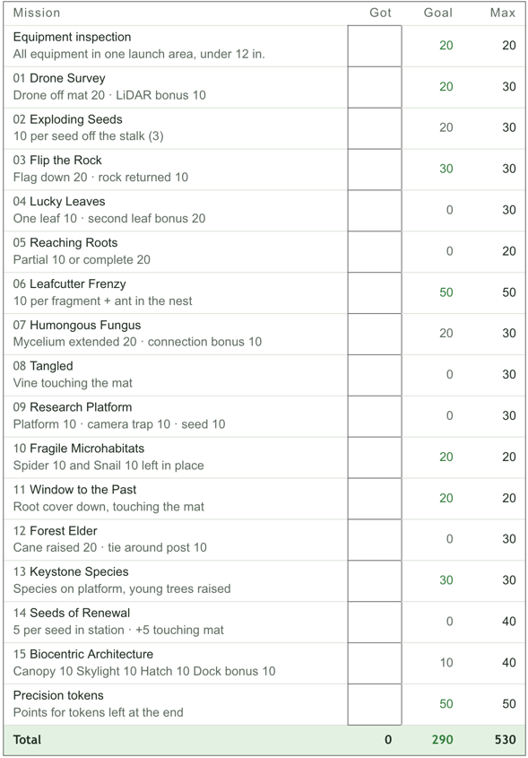

**Proud of Rosie Rover!** As a brand-new team, we used **Discovery, Innovation,
Impact, Inclusion, Teamwork, and Fun** to build it together.

*Thank you, judges!*
