<style>blockquote, table, pre, img { break-inside: avoid; } h2, h3 { break-after: avoid; }</style>

# Robot Design Talk: Team Script

**Rosie Robotics, Team #75872 · Robot: Rosie Rover**

This copy has **everything on the judges' handout**, plus the rubric and **what each
person says**. The judges' handout has the same pictures and tables, so when you point
at something here, the judges can find it on their copy.

We have **5 minutes**. We go in the same order as the judges' Robot Design rubric:
**Identify → Design → Create → Iterate → Communicate**.

**Tips for everyone**

- It's fine to read your words. Look up at the judges between sentences.
- Talk slower than feels normal, and loud enough for the back of the room.
- Hold up the robot, or point at the picture, when your part mentions it.
- When you finish, say the next person's name and step back.
- After the 5 minutes, the judges ask questions. **Anyone** can answer.

| # | Rubric | Speaker | Time | Judges' handout | Holding |
|---|---|---|---|---|---|
| 1 | Identify | Bowen | 1:30 | Pages 1–2 | The robot and the remote |
| 2 | Identify | Lina | 0:25 | Page 3 | Just her script |
| 3 | Design | Miriam | 0:30 | Page 4 | Mission 1 attachment |
| 4 | Design | James | 0:30 | Page 4 | The arm |
| 5 | Create | Jennie | 0:30 | Page 5 | Mission 13 attachment |
| 6 | Iterate | Neala | 0:45 | Page 6 | The keystone species |
| 7 | Communicate | Nolan | 0:45 | Page 7 | Nothing |
| 8 | Communicate | Mira | 0:10 | Page 7 (everyone stands together) | Nothing |
| | | | **≈ 5:05** | | |

---

## Judges' handout, page 1 (top)

**Rookie team · 2026 FLL Challenge: Bioglow · Robot: Rosie Rover · Coded in Pybricks (Blocks to Python)**

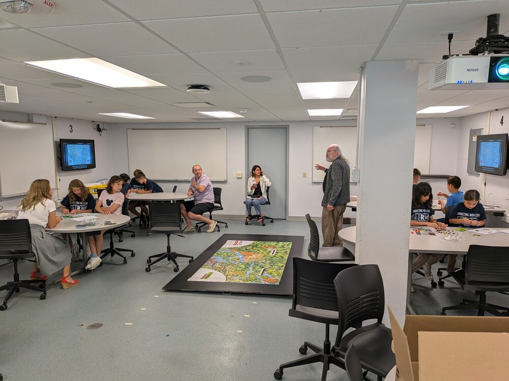 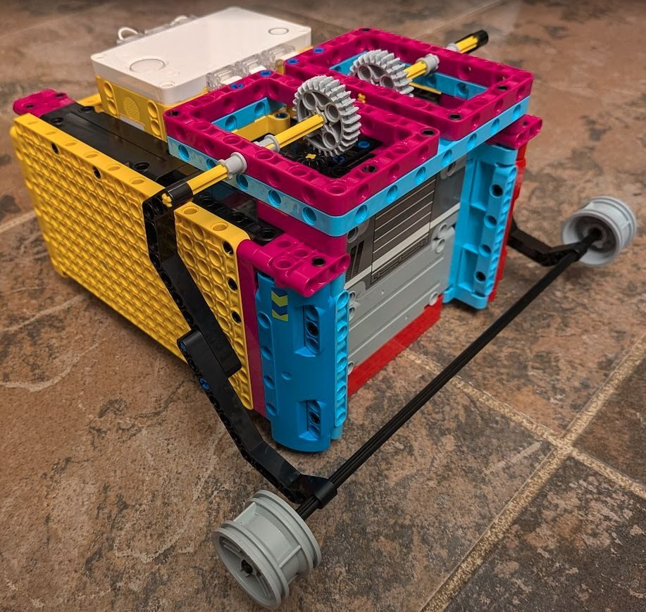

| Rubric | Who's talking | What we'll show |
|---|---|---|
| Identify | **Bowen**, **Lina** | Resources used, robot base, Pybricks + remote, mission strategy |
| Design | **Miriam**, **James** | Mission 1 Drone Survey plan, motor-driven arm (Mission 2 Exploding Seeds, Mission 7 Humongous Fungus) |
| Create | **Jennie** | Mission 13 Keystone Species code and attachment |
| Iterate | **Neala** | How testing changed Mission 13 Keystone Species |
| Communicate | **Nolan**, **Mira** | Lessons learned |

<div style="page-break-after: always"></div>

## 1. IDENTIFY: Resources & the Robot Base (Bowen, about 1 min 30 sec)

*Rubric: "explored building and coding resources, and sought guidance as needed."*

**On the judges' handout:**

- **As a rookie team, we started by learning from veteran teams.** The YouTube video
  *"5 Simple Tips to Build the Ultimate FLL Robot"* recommends building one strong
  **base robot** first, then small attachments for each mission.
- **Base:** built following the video's tips, then finished with an original design for the outside panels.
  It has 2 drive motors, **2 attachment motors on top**, and 2 color sensors.
  We made a Pybricks template program for this setup.

  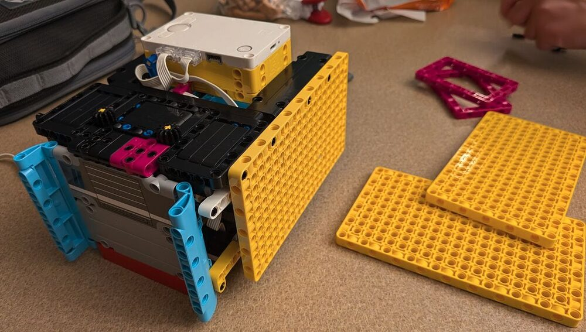 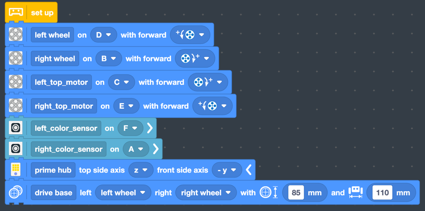

- **Pybricks instead of the regular SPIKE app:** missions start in Pybricks Blocks, then
  move to Python. Each mission is its own file, and all the code is on GitHub (https://github.com/Rosie-Rover-FLL/bioglow_2026).

  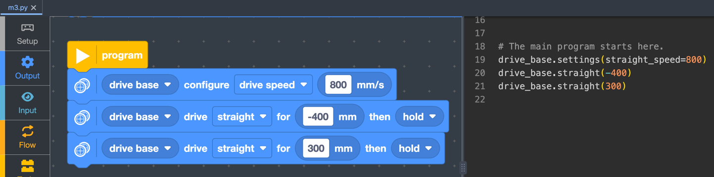

- **Mission menu on the hub:** press left/right to pick a mission number, center to run it.

  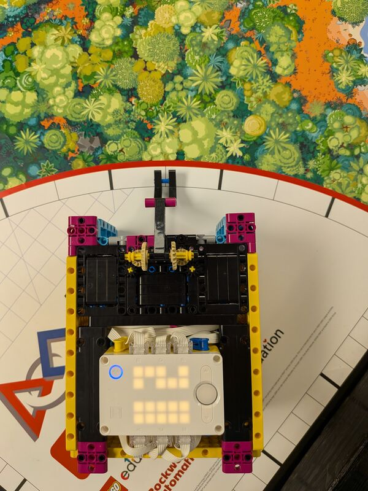

- **Custom remote control:** a second hub. Tilt it to drive, a knob sets the speed,
  and holding a button moves the arm. Used for driving practice and testing attachments. (live demo)

  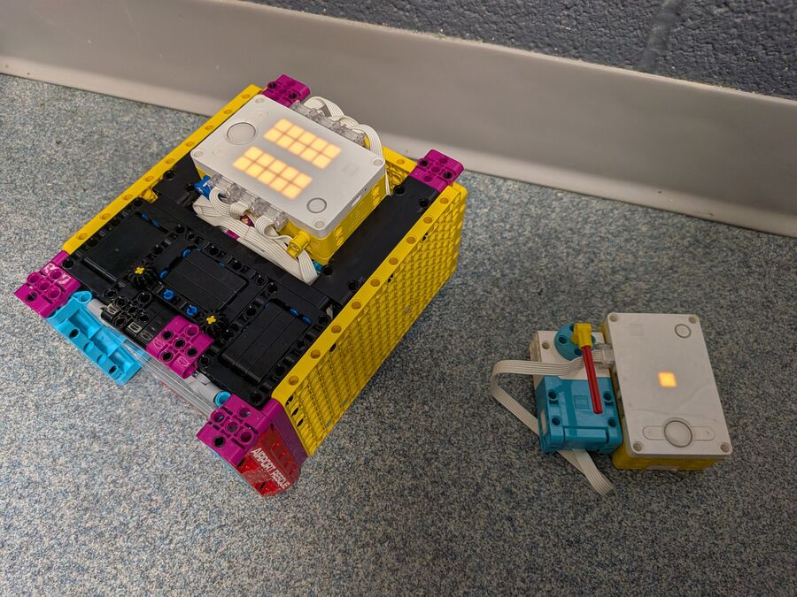

**Bowen is holding:** the robot and the remote.

### 🎤 Bowen says:

> Hi, my name is Bowen Fisher. We are Rosie Robotics, and I am here to present our
> robot, the Rosie Rover.
>
> This is our first year as a FIRST LEGO League team, so before starting any designs,
> we asked for advice from teams that have done this in the past.
>
> We found videos of ideas and robot designs. We found a video with a link to build a
> robot base, and we used it to make most of the Rosie Rover we have today.
> *[point to the top gears]* These are called **dog ears**. They run our entire
> attachment system.
>
> Instead of the SPIKE Prime app, we use **Pybricks**. We start with Blocks, then move
> that code to **Python**. We wrote a main mission program that can run all of our
> missions: the left and right buttons pick which mission, and the center button runs it.
>
> We also built a **remote control** out of a second hub. We use it **only for testing**.
> *[quick demo, about 5 seconds]*
>
> Next, Lina will present how we picked our missions.

**Bowen's notes (don't read out loud):**
- If a judge asks "why Pybricks?": we can write Python, every mission lives in its own
  file, the code is all saved on GitHub, and we could build a mission menu and a remote.
- The remote is only for practice. Remote controls aren't allowed in matches.

<div style="page-break-after: always"></div>

## 2. IDENTIFY: Mission Strategy (Lina, about 25 sec)

*Rubric: "determined which missions to attempt" (mission strategy).*

**On the judges' handout:**

Missions chosen for **reliability** and the **easiest points**: close to
a launch area, with simple moves.

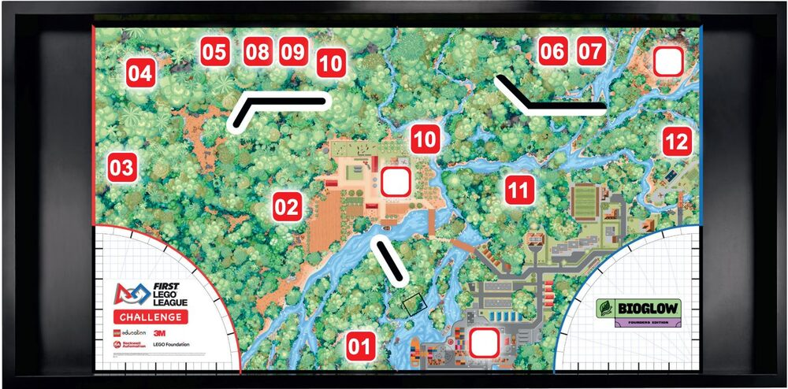

| Mission | Goal pts |
|---|---|
| Equipment inspection | 20 |
| 01 Drone Survey | 20 |
| 02 Exploding Seeds | 20 |
| 03 Flip the Rock | 30 |
| 06 Leafcutter Frenzy (also scores 11 Window to the Past) | 50 |
| 07 Humongous Fungus | 20 |
| 10 Fragile Microhabitats (don't touch it!) | 20 |
| 11 Window to the Past | 20 |
| 13 Keystone Species | 30 |
| 15 Biocentric Architecture | 10 |
| Precision tokens | 50 |
| **Goal** | **290** |

**Lina is holding:** just her script.

### 🎤 Lina says:

> There are 15 missions, and no one can do them all. As a new team, we chose
> missions that we can do **easily and reliably**, and that we could get **maximum
> points** from without extremely complex navigation. The map and table show the
> missions we chose. Our goal is to obtain around **290 points**.
>
> Now Miriam and James will tell you how we designed our attachments.

---

## 3–4. DESIGN: Mission 1 Drone Survey and the Arm (Miriam and James)

*Rubric: "all team members contributed ideas" and "building and coding skills in all team members."*

**On the judges' handout:**

**Mission 1 Drone Survey (Miriam):** the robot drives backward fast to knock
the drone off the mat, then drives straight home.

**The arm, Mission 2 Exploding Seeds (James):** both top motors turn the arm together. The first version was too weak,
so the speed went way up. The arm lowers again on the way home, ready for the next run.
We might even be able to use the same arm for **Mission 7 Humongous Fungus**.

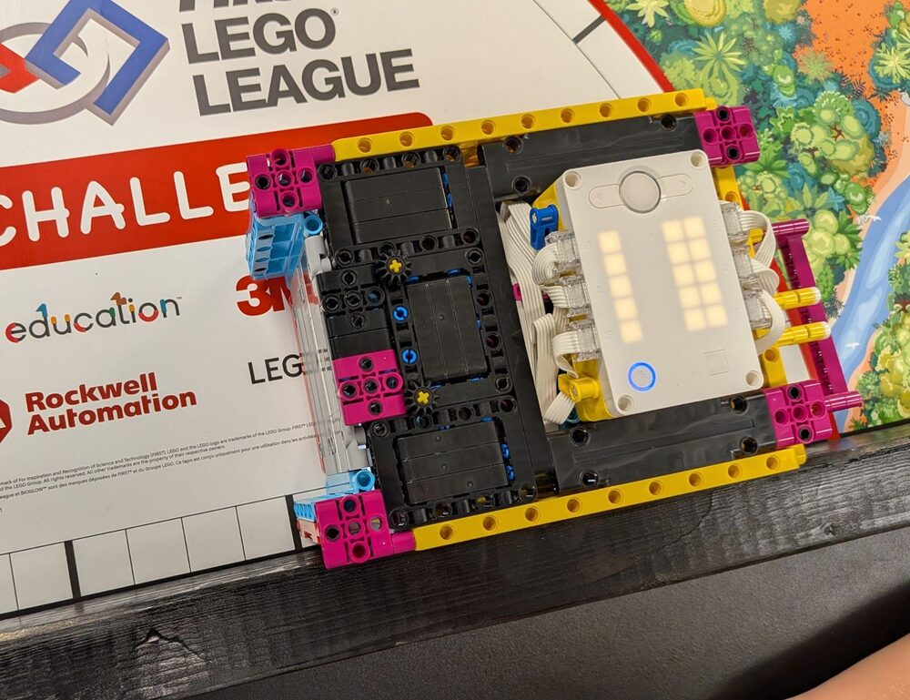 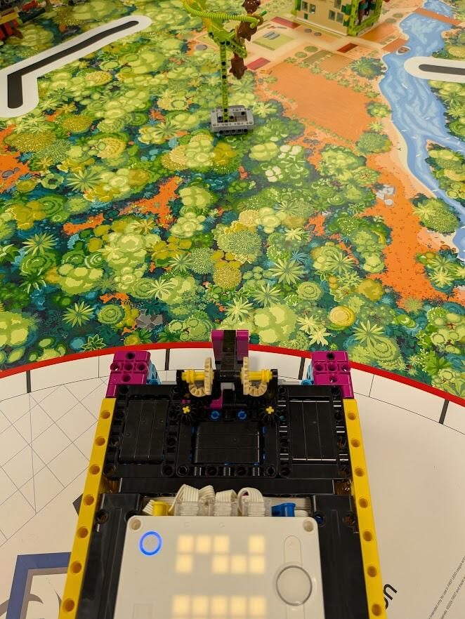

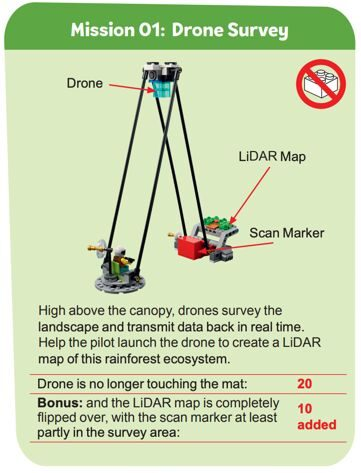 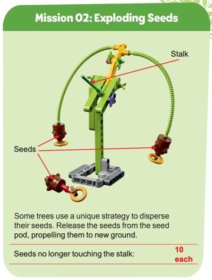 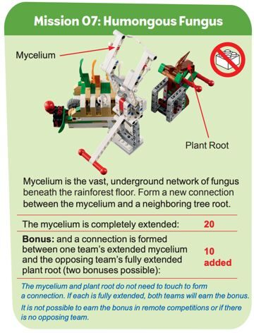

**Miriam is holding:** the Mission 1 attachment.

### 🎤 Miriam says (about 30 sec):

> I decided to try to accomplish the drone survey (mission 1).
> I built an attachment, but my first version did not work but when
> tinkered with the attachment to make it better my second version worked.
>  Here is my attachment.
> The robot is turned so it is facing backwards and against the wall then it
>  drives forward to push the red thing forward so the drone is in the air.
>  I built the attachment, tested the robot, and measured how far it should go forward and backward.
>  I tested and it worked 3 times in a row.
> 

>
> Now James will tell you about our arm.

**James is holding:** the arm.

### 🎤 James says (about 30 sec):

> I worked on **the arm**. Both top motors turn it together. For **Mission 2,
> Exploding Seeds**, the robot drives up and lifts the arm to knock the seeds off.
> At first the arm was **too weak**, so we made it go much faster, and then it
> worked. We might even be able to use the same arm for **Mission 7, Humongous Fungus**.
>
> Now Jennie will tell you about Mission 13, Keystone Species.

<div style="page-break-after: always"></div>

## 5. CREATE: Mission 13 Keystone Species (Jennie)

*Rubric: "clear explanation of innovative attachments and their purpose" and
"clear explanation of innovative code and/or sensor use."*

**On the judges' handout:**

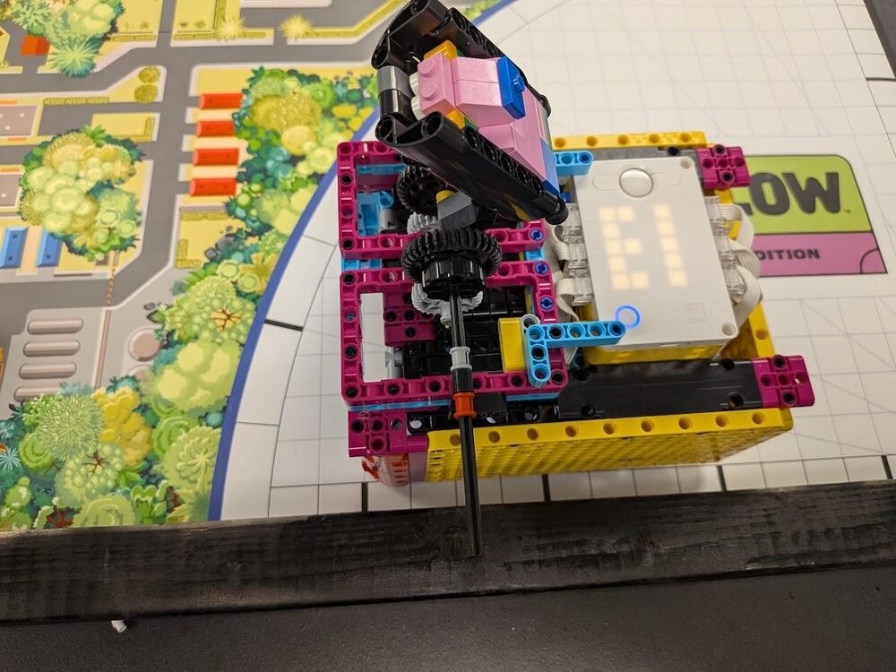 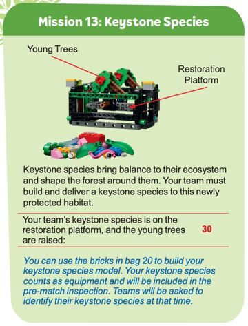

**Keystone species:** a poison dart tree frog. It eats huge numbers of insects and is
food for other animals, so it holds the food web together.

**Attachment:** connects to the top motors with gears, and throws the
keystone species onto the restoration platform.

**Code (Jennie):** first written in Pybricks Blocks. Drive to the platform, run both top
motors at 75% power for 0.4 seconds, then back up.

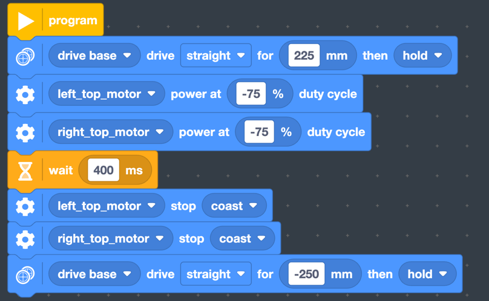

**Jennie is holding:** the Mission 13 attachment.

### 🎤 Jennie says (about 30 sec):

> I wrote the code for **Mission 13, Keystone Species**. Our keystone species is a
> **poison dart tree frog**. It eats a lot of insects, and other animals eat it.
> I also helped do **Mission 7, Mycelium**. They both involved the attachment.
> *[hold up the attachment]*
>
> Neala will tell you how testing changed Mission 13.

---

## 6. ITERATE: How Testing Changed Mission 13 Keystone Species (Neala, about 45 sec)

*Rubric: "repeated testing" and "improvements based on testing."*

**On the judges' handout:**

Repeated test runs showed two problems:

| Problem found in testing | Fix |
|---|---|
| Not enough power to raise the young trees | Added **weight** to the keystone species, started the attachment **farther back** for more momentum, and raised the throw from 75% to **100% power** |
| The species sometimes missed the center of the platform | Drive out **slower** (300 mm/s) to stop wheel slip, but still drive back **fast** (600 mm/s) |

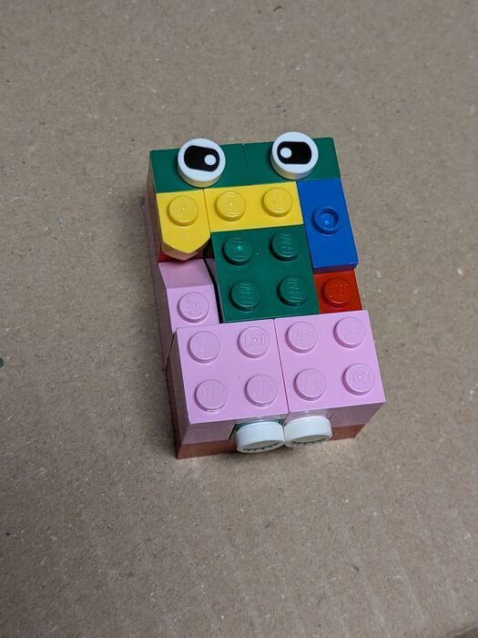

These edits were made directly in the Python code (changes marked `◀`):

```python
drive_base.settings(straight_speed=300)   # ◀ NEW: slow drive out, no wheel slip
drive_base.straight(225)
left_top_motor.dc(-100)                   # ◀ was -75: full-power throw
right_top_motor.dc(-100)                  # ◀ was -75
wait(400)
left_top_motor.stop()
right_top_motor.stop()
drive_base.settings(straight_speed=600)   # ◀ NEW: fast drive home
drive_base.straight(-250)
```

**Neala is holding:** the keystone species.

### 🎤 Neala says:

> We tested Mission 13 **over and over**, and testing showed two problems.
>
> **First**, there wasn't enough power to raise the young trees. So we made our
> keystone species **heavier** *[hold it up]*. We also start the attachment
> **farther back**, so it has more momentum when it hits the target.
>
> **Second**, the species sometimes missed the center of the platform. The wheels
> were slipping, so we made the robot drive out **slower**. It still drives back
> **fast** to save time.
>
> We made those changes right in the Python code. The arrows on the handout show
> what we changed. Now Mission 13 works almost every time.
>
> Nolan will tell you what we learned.

<div style="page-break-after: always"></div>

## 7–8. COMMUNICATE: Lessons Learned (Nolan, then Mira)

*Rubric: "detailed explanation of process and lessons learned" and "team clearly shows
pride or enthusiasm for their work."*

**On the judges' handout:**

1. **A robot doesn't do the same thing every time.** The battery, where the robot is
   placed, and wheel slip all matter. The fixes: stall-detect code (if the robot gets stuck,
   it stops and moves on), and gentler starts so the wheels don't slip.
2. **Precision tokens are worth protecting.** Each touch of the robot outside home
   costs a token. Sometimes it's smarter to let a mission fail.
3. **Practice runs taught us the scoring.**

| | Score |
|---|---|
| First full practice run (Oct 11) | 180 |
| *...many more runs not shown...* | ... |
| Practice run (Nov 1) | 230 |
| Practice run (Nov 8) | 220 |
| Current goal | **290** |

The score sheet used at every practice run:

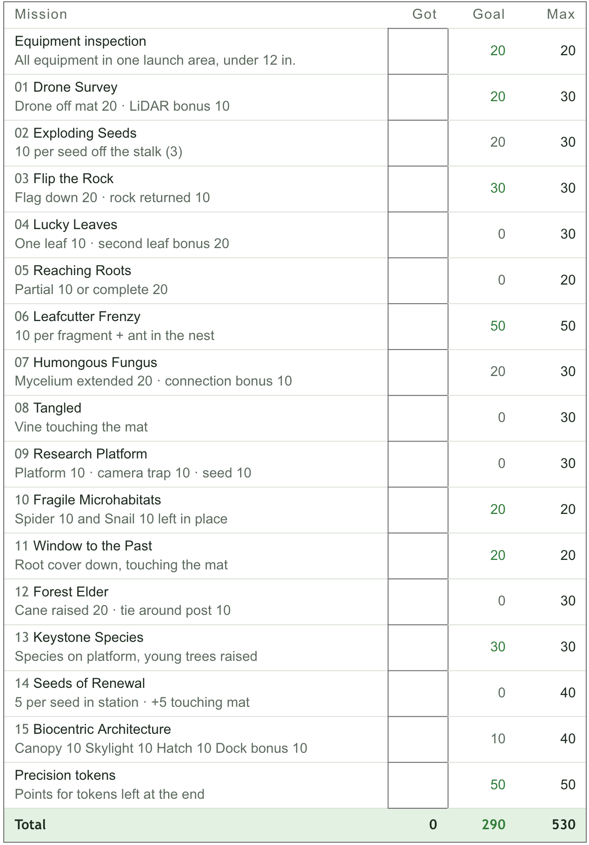

**Proud of Rosie Rover!** As a brand-new team, we used **Discovery, Innovation,
Impact, Inclusion, Teamwork, and Fun** to build it together.

*Thank you, judges!*

**Nolan is holding:** nothing.

### 🎤 Nolan says (about 45 sec):

> We learned three big things.
>
> **One:** a robot doesn't do the same thing every time. The battery, where you place
> the robot, and wheel slip all change things.
>
> **Two:** precision tokens are worth protecting. Each time we touch the robot outside
> home, it costs us a token. So sometimes it's smarter to let a mission fail.
>
> **Three:** practice runs taught us the scoring. We fill out this score sheet at every
> practice. Our first full run on October 11th scored **180**. On November 1st we
> got **230**, and last week **220**, which shows how much runs can change. Our goal
> is **290**.
>
> Mira will finish for us.

**Mira is holding:** nothing.

### 🎤 Mira says (about 10 sec):

> We're really proud of Rosie Rover! As a brand-new team, we used **discovery,
> innovation, impact, inclusion, teamwork,** and **fun** to build it together.
> Thank you, judges! We're ready for your questions.

*(Everyone smiles.)*

---

## Practice questions judges might ask

Practice these out loud. Anyone can answer.

- What was the hardest part of building the robot? How did you fix it?
- Who did the coding? Did everyone code? *(Everyone should be able to say one thing they coded.)*
- Do you use any sensors? *(We have two color sensors. CHECK: what we use them for)*
- How do you make the robot start in the same place every time?
- What would you change if you started over?
- How did you decide who works on which mission?
- What's your favorite mission and why?
- What is your keystone species, and why is it a keystone species? *(The referee also asks this at the pre-match inspection.)*
